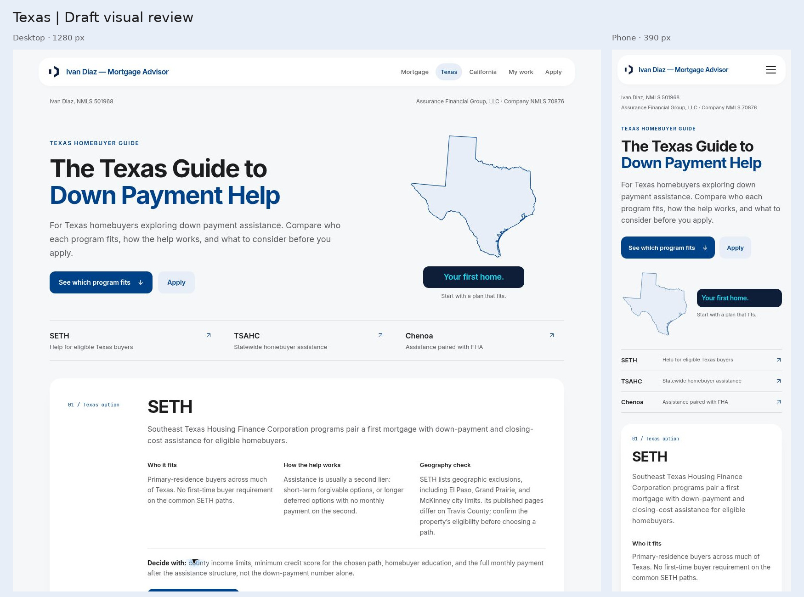
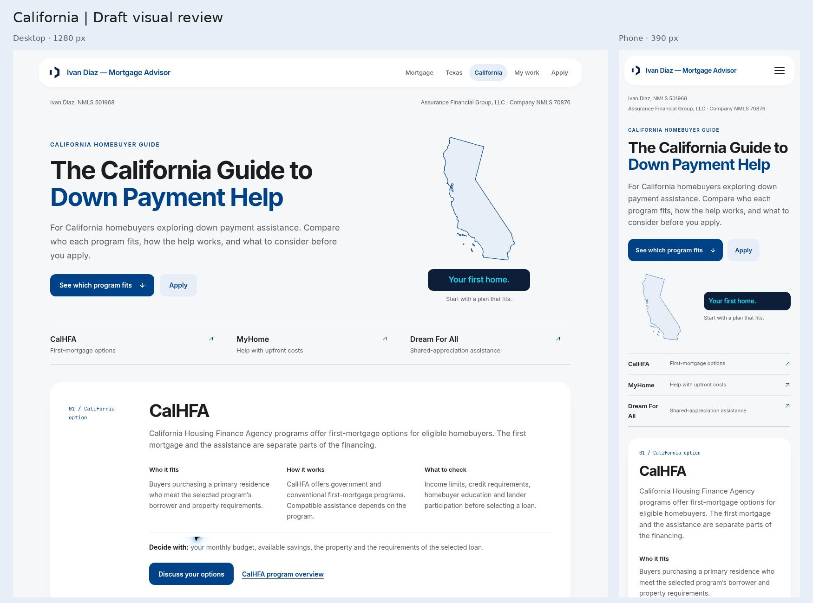
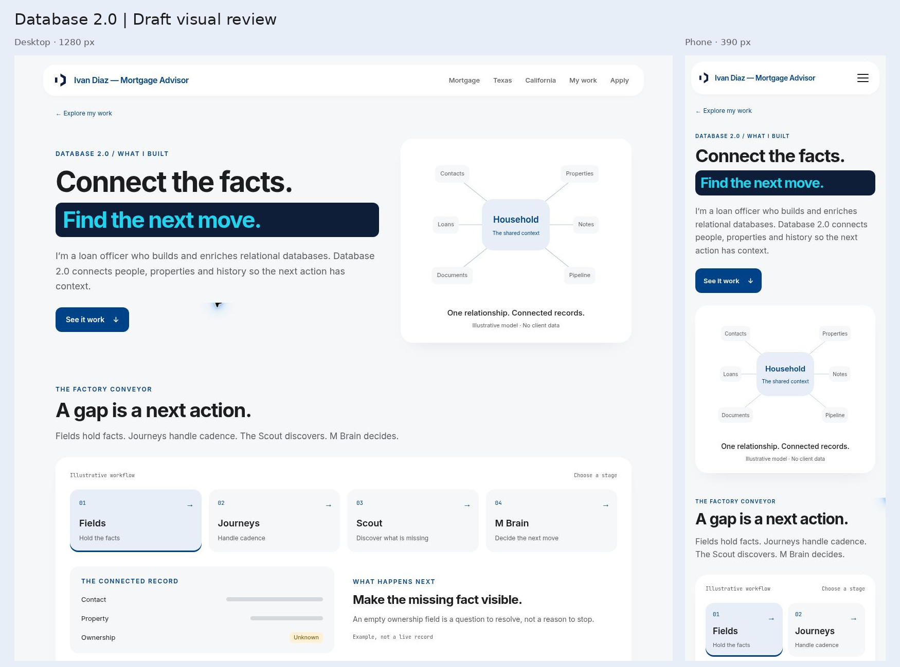
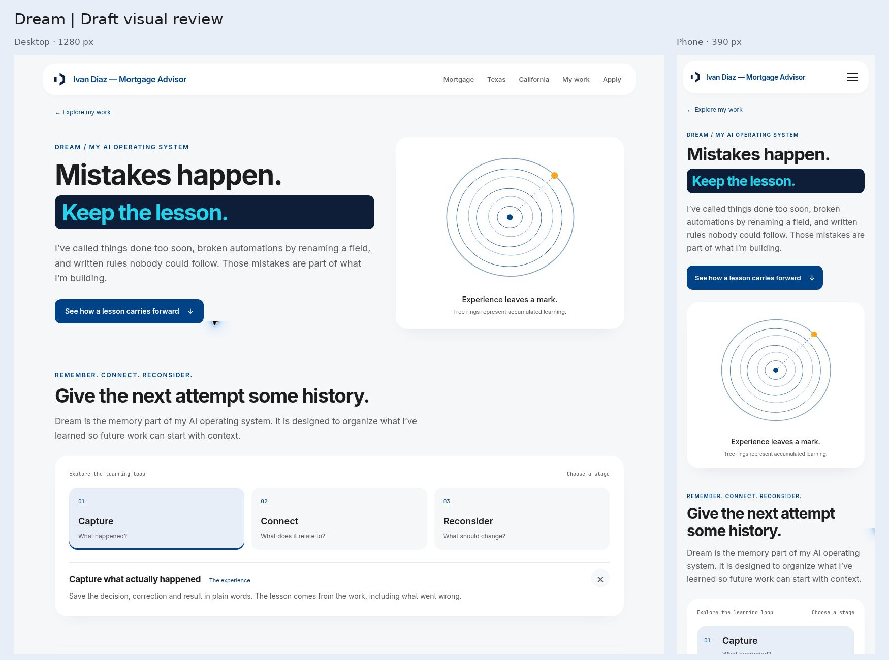

# Four-page visual review

Review for Ivan Diaz and Claude. Draft PR [#79](https://github.com/ideeazz1/ivanAdiaz-site/pull/79). **No merge or publication is authorized.**

These are screenshots of the implemented pages at code commit `2e991e7b830d83638b795729085a7d9f550c00fb`, not design mockups. Paired images show desktop on the left and phone on the right. Full-page images are linked below each pair.

## Review brief

Please give Ivan an independent second opinion on the actual design and code. Compare the four pages against `experience/projects/motion/source/STYLE.md`: preserve the rotating cyan heading, typography, and existing site structure. Prioritize phone readability, spacing, visual hierarchy, clear commercial copy, and whether the Database 2.0 and Dream stories show the work in plain words.

Texas: preserve program content; headline “The Texas Guide to Down Payment Help,” left-aligned with no glow or staggered indent; accurate contained Texas outline; audience/benefit subhead; primary “See which program fits” jumps to programs; secondary “Apply”; short descriptors for SETH, TSAHC, and Chenoa; no excess mobile hero gap. California should match its layout and quality with state-specific content. Site name: “Ivan Diaz — Mortgage Advisor.” NMLS must be visible near the top. Flag any number-based financing headline for Assurance compliance review.

Database 2.0: a relational client database that turns every gap into a next action. Fields hold facts, journeys handle cadence, the Scout discovers, M Brain decides. Dream: Ivan’s AI operating system story, in plain words. Position Ivan as a loan officer who builds and enriches relational databases; mistakes, not credentials, are his authority. No client data or unsupported performance claims.

Mortgage disclosures: Ivan Diaz, NMLS 501968; Assurance Financial Group, LLC, Company NMLS 70876; state licensing; Equal Housing Opportunity. END claim review and sources are recorded in the PR description. Do not infer missing license numbers.

## Known open items

- Visible TODO: Ivan’s Texas SML license number.
- Visible TODO: confirm whether a separate Texas company registration number must be displayed.
- Visible TODO: Ivan’s individual California DFPI license number.
- California company license 41DBO-73861 is sourced in the PR.
- Ivan’s visual approval is still pending.

## Capture and validation

All four pages were rendered at 320, 390 and 1280 px; document and viewport widths matched without horizontal overflow. Images here are 390 px phone and 1280 px desktop. Arrival transitions were disabled only in the capture wrapper to show completed static content. The production animation remains in the source. Dream stage selection and detail-close were tested. These captures do not establish a full interaction regression, accessibility audit, or native-device test.

## Texas — /mortgage/texas

[Full phone screenshot](texas-390-full.jpg) · [Full desktop screenshot](texas-1280-full.jpg)

## California — /mortgage/california

[Full phone screenshot](california-390-full.jpg) · [Full desktop screenshot](california-1280-full.jpg)

## Database 2.0 — /experience/database-2

[Full phone screenshot](database-2-390-full.jpg) · [Full desktop screenshot](database-2-1280-full.jpg)

## Dream — /experience/dream

[Full phone screenshot](dream-390-full.jpg) · [Full desktop screenshot](dream-1280-full.jpg)
